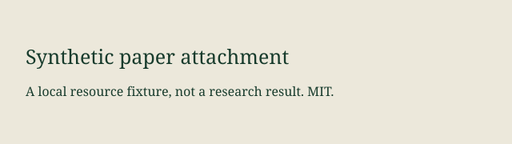

# Synthetic Paper

## Methods

This synthetic example tests structure, not scientific accuracy.



[Dataset][data]

[data]: https://data.invalid/example

## Code example

```md
#### This is not a document heading

[Quoted][undefined]
$ is not a math diagnosis
```

Inline example: `[Example][not-a-reference]` costs $5.
